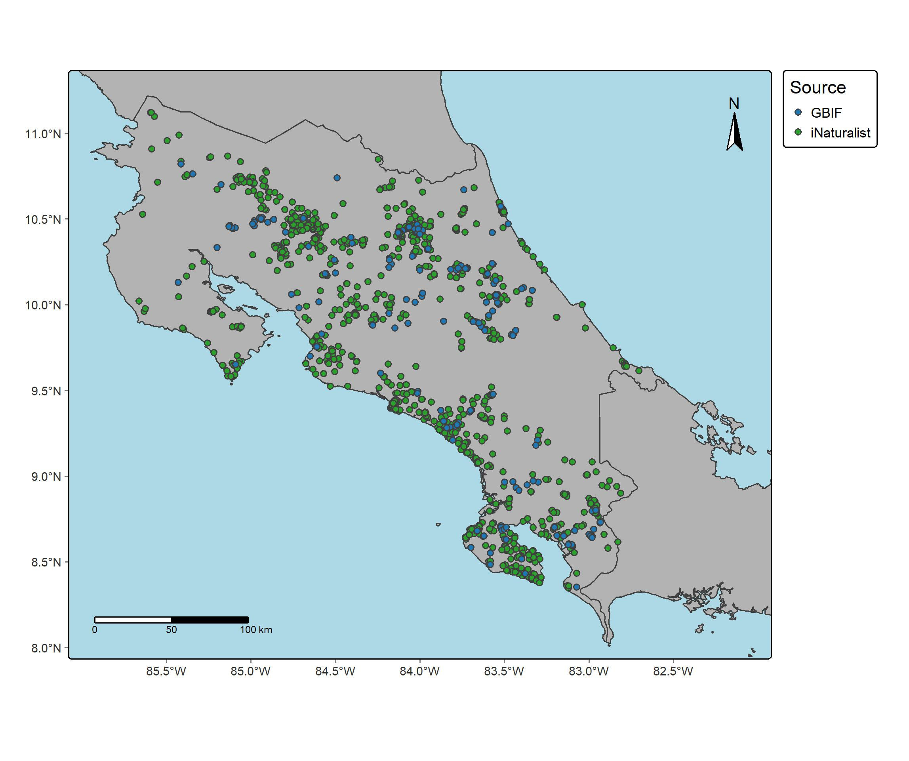

En esta práctica se utilizaron los paquetes rgbif y rinat para descargar ocurrencias de la especie de anuro *Craugastor fitzingeri* en Costa Rica. Para el ordenamiento de datos se utilizó el paquete Tidyverse y para la limpieza de datos espaciales se utilizó principalmente el paquete CoordinateCleaner. El mapeo de ocurrencias se realizó con los paquetes sf y tmap. El objetivo de esta práctica fue aprender el proceso de descarga de ocurrencias desde una API y su posterior limpieza para crear juegos de datos robustos que puedan utilizarse en análisis espacial. Posterior a la limpieza se construyó un juego de datos preliminar de 1850 ocurrencias, de las cuáles 440 pertenecían a GBIF y 1410 a iNaturalist (Figura 1). En este ejercicio aprendí las bases de la importación de datos desde iNaturalist y GBIF; sin embargo, existe alta heterogeneidad en los datos descargados y el proceso de limpieza es complejo. Una ventaja es que los códigos utilizados funcionan con cualquier clado y en cualquier región del mundo.

